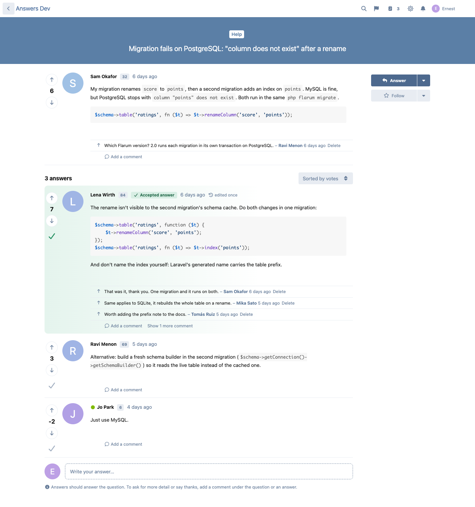
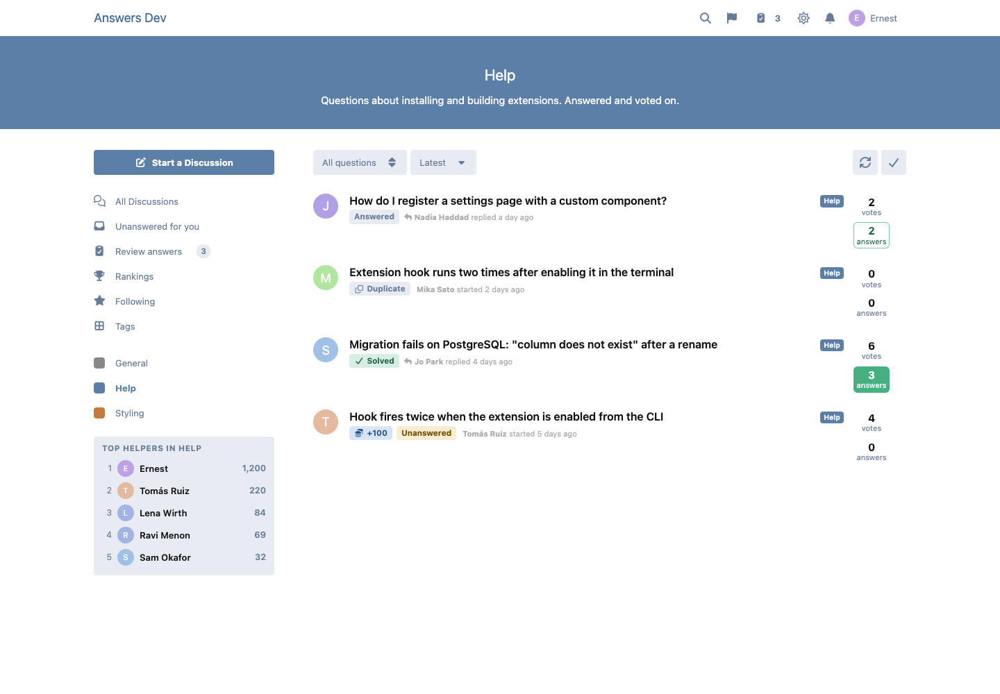
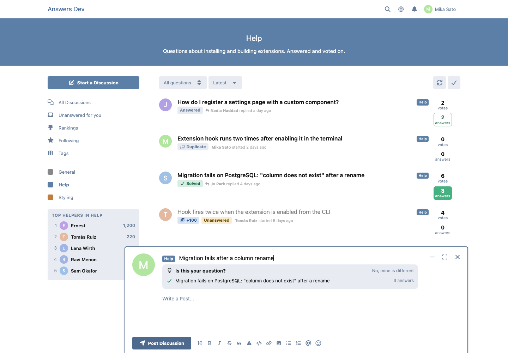
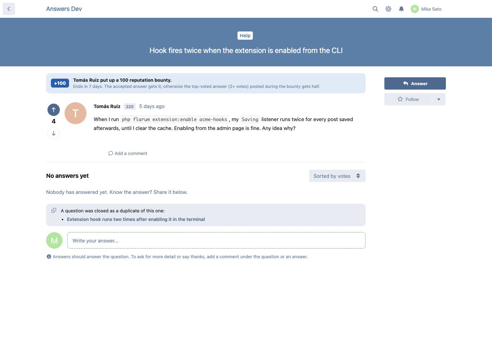
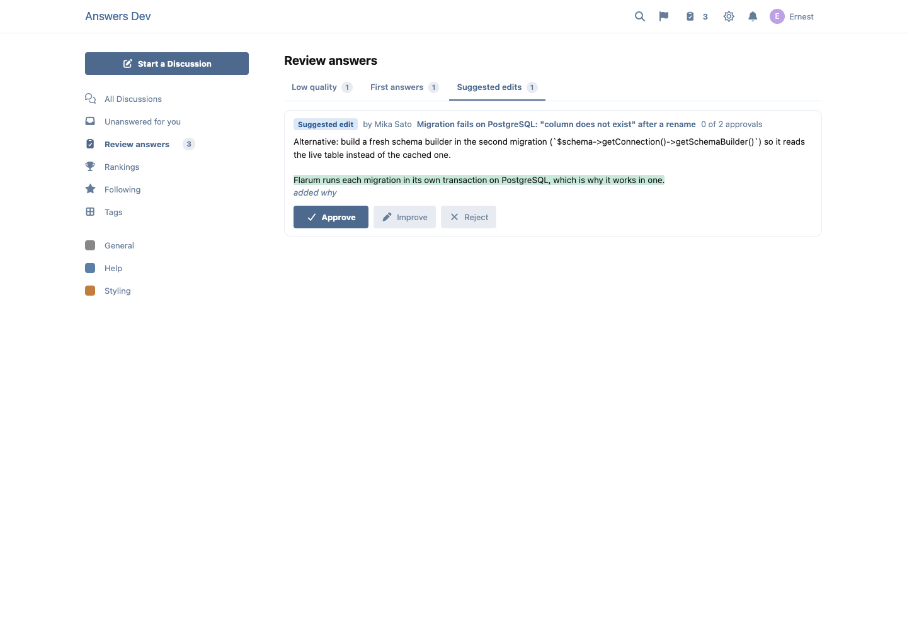

# Answers

Stack Overflow–style questions and answers for any Flarum 2 tag. Free and MIT.



Turn a tag into Q&A and its discussions become questions:

- **Answers sorted by votes**, the accepted answer pinned on top, and a short **comment thread** under each answer, so answers stay answers (switch comments off per tag for a leaner layout).
- **Votes and reputation per tag** ("Top helpers in Help"), on each member's profile, and beside names in threads.
- **Question states**: Unanswered, Answered, Solved, Closed as duplicate (linked to the original), with a filter on the tag page and an **Unanswered for you** feed (tags you follow with FoF Follow Tags, or every Q&A tag).
- **"Is this your question?"**: similar solved questions appear while someone types a title.
- **Bounties** in reputation, or in Money when antoinefr/money is installed. The accepted answer gets it; when time runs out, the top-voted answer posted during the bounty with 2+ votes gets half.
- **Community editing**: trusted members improve answers, everyone else can suggest an edit. Every change is kept, with word-level diffs and roll back.
- **Review queue** for low-quality answers, a member's first answer and suggested edits.









## Install

```sh
composer require ernestdefoe/answers
php flarum migrate
php flarum cache:clear
```

Enable it, then edit a tag on the Tags page and switch on **Questions and answers**. Bounties close on Flarum's scheduler (`php flarum schedule:run` every minute).

## Works with

- **FoF Best Answer**: one click (or `php flarum answers:import-best-answer`) imports its Q&A tags and best answers as accepted answers. Its button steps aside on questions.
- **FoF Gamification**: each vote is also cast there, so its points, ranks and leaderboard count it; its own vote buttons are hidden on questions.
- **Money** (antoinefr/flarum-ext-money), **FoF Follow Tags**, **Approval**, **GDPR**.

Permissions (tag-scoped): vote, start bounties, suggest edits, edit others' answers, review, vote to close, and moderate questions. Editing others' answers, reviewing and voting to close also need reputation in the question's tag (1000 and 500 by default; moderators need none).

For other extensions: `ErnestDefoe\Answers\Event\AnswerAccepted`, `AnswerUnaccepted`, `QuestionClosedAsDuplicate`, `BountyStarted`, `BountyAwarded` and `ReputationChanged`, plus `users.answers_accepted_count` and `answers_solved_count`.

## Support

[Buy me a coffee](https://buymeacoffee.com/ernestdefoe) if it helps your community.
